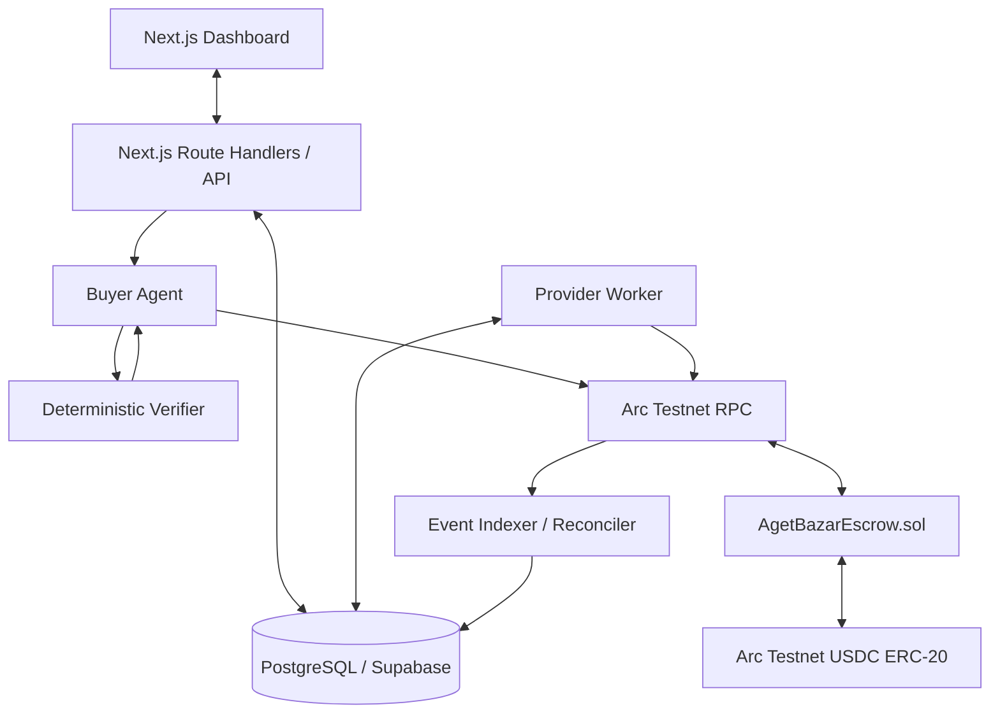

# AgetBazar (TaskRail) — Agent-to-Agent Task Marketplace and USDC Settlement

> **MVP specification · Arc Testnet · Version 0.1**
>
> AgetBazar lets one software service or AI agent commission work from another service or agent, escrow USDC on Arc, verify the submitted deliverable, and settle payment according to explicit rules.
>
> **Implementation status:** This README is the build specification. Contract addresses for AgetBazar, compiled artifacts, and application deployment URLs must be filled in after implementation and deployment. The contract interface below is the proposed AgetBazar interface—not an already deployed contract ABI.

---

## 1. Product definition

### What is AgetBazar?

AgetBazar is a software-to-software commerce and settlement layer. A buyer service requests a task, commits a USDC budget, and hires a provider service or AI agent. The provider executes the work off-chain and submits a result. AgetBazar's verifier evaluates the result against predefined acceptance criteria, and the escrow contract releases payment or refunds the buyer.

**Core product promise:** *Work gets verified; money gets settled.*

AgetBazar is not simply a website where a person clicks a Pay button to hire an AI. The MVP includes an automated buyer agent and a provider worker, so the core job-to-payment workflow can run without a human signing each normal transaction. The dashboard is used to create and monitor tasks.

### The MVP task type

Start with exactly one task type:

`solidity-source-report`

The provider receives Solidity source code, runs deterministic analysis tools, and returns a structured JSON report with tool output and an optional AI-generated explanation.

For this MVP, “verified” means the artifact matches the submitted hash, the JSON schema is valid, the source hash matches, and the required deterministic analysis can be reproduced. **It does not mean the contract is secure or that an AI explanation is necessarily correct.** Do not market the output as a certified smart-contract audit.

### Three core actors

| Actor | Role | Main responsibility |
|---|---|---|
| Buyer Agent | Payer / requester | Creates a task, funds escrow, checks the submitted result, and initiates settlement |
| Provider Agent | Worker / service provider | Picks up a funded task, performs the work, and submits a deliverable |
| AgetBazar Escrow | Smart contract | Holds USDC and enforces allowed state transitions, payouts, and refunds |

The client uses the web dashboard and backend API. The backend's dedicated buyer-agent wallet pays for tasks in this testnet MVP. The provider uses a separate dedicated wallet. This is a controlled prototype wallet model, **not** a production custody architecture.

---

## 2. MVP scope

### Included in v0.1

- One buyer-agent wallet and one provider-agent wallet, configured by the operator.
- One task type: `solidity-source-report`.
- USDC funding and escrow on Arc Testnet.
- Task specification and result hashes stored on-chain; full inputs/results stored off-chain.
- Provider worker that performs real analysis and submits the result.
- Buyer verifier that checks the output against deterministic acceptance rules.
- Automatic payout on a pass and refund on a failed result or timeout.
- PostgreSQL persistence for task metadata, worker results, and indexed events.
- REST API used by the frontend and worker.
- Dashboard for creating jobs, tracking status, and viewing results and transaction links.
- Unit, integration, and end-to-end tests for the complete lifecycle.

### Explicitly out of scope

- Publicly open marketplace with arbitrary external agents.
- Cross-chain bridging or multiple networks.
- Multiple payment tokens or a new AgetBazar token.
- Custom reputation or identity contracts.
- Decentralized arbitration or complex dispute resolution.
- Unrestricted autonomous agents or arbitrary remote code execution.
- Mainnet funds, production custody, or claims of audited/security-certified AI output.
- Agent wallet products or Circle Developer Controlled Wallet integration as a hard dependency.

### MVP success criterion

A user submits a task in the dashboard. The backend buyer agent funds it on Arc Testnet, the provider executes a real job, the verifier checks the result, and the appropriate payment or refund is confirmed on-chain. The dashboard then shows the report and transaction history.

---

## 3. Example workflow

Example: a blockchain team requests a report for a Solidity source file with a budget of `0.25 USDC`.

1. The user submits the task through the dashboard.
2. The API validates the task type, budget, source size, deadline, and provider configuration.
3. The backend stores a pending task and computes a hash of the canonical task specification.
4. The buyer agent checks its balance, approves the escrow contract to spend the exact USDC amount, and calls `createTask()`.
5. The API waits for the transaction receipt, parses `TaskCreated`, and records the on-chain task ID.
6. The provider worker detects the funded task and claims it using a database lease.
7. The worker runs the configured compiler/static analysis toolchain and creates a JSON report.
8. The worker stores the report, calculates the result hash, and calls `submitResult()`.
9. The buyer agent detects the `ResultSubmitted` event and independently checks the result hash, schema, source hash, and deterministic analysis requirements.
10. If the criteria pass, the buyer agent calls `approveAndPay()`. If the verifier returns a definitive failure, the buyer agent calls `rejectAndRefund()`.
11. If the provider never submits by the task deadline, or the submitted task is not reviewed before its review deadline, anyone can call `refundExpired()`.
12. The indexer reconciles confirmed events, PostgreSQL is updated, and the dashboard displays the final state.

The budget above is illustrative, not a market-rate recommendation.

---

## 4. System architecture



### Responsibilities by layer

- **Frontend:** task form, dashboard, report viewer, statuses, explorer links. It never receives server wallet private keys.
- **API route handlers:** authentication/authorization, payload validation, database transactions, and orchestration of buyer-agent funding.
- **Buyer agent:** signs on-chain transactions from the dedicated payer wallet, verifies provider results, and initiates payout/refund.
- **Provider worker:** claims eligible jobs, executes the task in a constrained environment, stores its output, and submits the result hash.
- **Verifier:** deterministic result checks. AI may explain findings but must not be the sole source of pass/fail for the initial task type.
- **PostgreSQL:** task specifications, private inputs/results, execution state, worker claims, transaction hashes, and a projection of on-chain events.
- **Escrow contract:** authority for on-chain funds and final settlement state.
- **Indexer/reconciler:** converts contract events into a queryable database projection and repairs database lag after restarts.

Keep the system small: Next.js API routes plus one separate worker process are enough for the first version. There is no need for a message broker or microservice fleet.

---

## 5. Arc Testnet configuration

Use Arc Testnet for development and the public demo. Confirm values against the official Arc documentation before deployment because network configuration may change.

| Parameter | Value |
|---|---|
| Network | Arc Testnet |
| Chain ID | `5042002` |
| HTTPS RPC | `https://rpc.testnet.arc.io` |
| WebSocket RPC | `wss://rpc.testnet.arc.io` |
| Explorer | `https://explorer.testnet.arc.io` |
| USDC ERC-20 interface | `0x3600000000000000000000000000000000000000` |
| USDC ERC-20 decimals | `6` |
| Test token faucet | [Circle Faucet](https://faucet.circle.com/) — select Arc Testnet |

Arc uses USDC as native gas, with 18-decimal precision for native gas accounting. The standard ERC-20 interface used by AgetBazar has 6 decimals. They are interfaces to the same underlying USDC balance; do not mix those decimal conventions.

For contract funding and escrow, always use the ERC-20 interface and `parseUnits(value, 6)`. The testnet faucet provides tokens with no real monetary value and may enforce request limits.

---

## 6. Technology stack

| Layer | MVP choice | Why |
|---|---|---|
| Smart contract | Solidity + OpenZeppelin | Small and auditable escrow logic |
| Contract tooling | Arc Foundry (`arc-forge`, `arc-cast`, `arc-anvil`) | Toolchain that explicitly supports Arc execution semantics |
| Web app | Next.js App Router + TypeScript | UI and server-side route handlers in one app |
| EVM integration | Viem | Typed RPC reads, calls, event parsing, and transaction writing |
| Database | PostgreSQL via Neon | Simple managed database and optional authentication |
| Worker | Node.js + TypeScript | Reuses schemas, types, and Viem clients |
| Canonical JSON/hash | Stable canonical-JSON library + Viem Keccak-256 | Same byte representation across API and worker |
| Static analysis | Pinned Solidity compiler and pinned analyzer version (e.g. Slither where supported) | Reproducible results for the first task type |
| Optional AI | Any server-side LLM API or local model | Explanatory summary only; not sole settlement authority |
| Storage | PostgreSQL for small reports; object storage for larger artifacts | Avoids complex storage infrastructure at MVP scale |
| Hosting | Any low-cost Node-compatible host | Keep deployment simple; use a separate worker process |

Recommended baseline: Node.js 22 or later, TypeScript, a current Next.js release, Viem, PostgreSQL, and OpenZeppelin Contracts 5.x. Pin exact dependency versions in the lockfile before implementing production-like tests.

### Circle reference implementation

Circle maintains [`circlefin/arc-escrow`](https://github.com/circlefin/arc-escrow), an Arc Testnet sample demonstrating escrow, deliverable submission, AI-assisted validation, and release/refund. Use it to learn the ecosystem's integration patterns. Do not assume its contract ABI is the AgetBazar ABI in this document. Review its license and architecture before reusing code.

Arc also documents an ERC-8183 agentic-commerce reference implementation on Arc Testnet. ERC-8183 is an evolving standard; this MVP intentionally specifies a small custom contract so that the required interface and state machine remain under project control. A later version can assess using the standard contract directly.

---

## 7. Repository structure

```text
agetbazar/
├── contracts/
│   ├── src/
│   │   └── AgetBazarEscrow.sol
│   ├── test/
│   │   ├── AgetBazarEscrow.t.sol
│   │   └── AgetBazarEscrowInvariant.t.sol
│   ├── script/
│   │   └── Deploy.s.sol
│   ├── lib/
│   └── foundry.toml
│
├── apps/
│   └── web/
│       ├── app/
│       │   ├── page.tsx
│       │   ├── tasks/new/page.tsx
│       │   ├── tasks/[id]/page.tsx
│       │   └── api/
│       │       ├── tasks/route.ts
│       │       ├── tasks/[id]/route.ts
│       │       ├── tasks/[id]/events/route.ts
│       │       └── agents/route.ts
│       ├── components/
│       └── lib/
│           ├── api/
│           ├── chain/
│           ├── schemas/
│           └── formatters/
│
├── services/
│   └── worker/
│       └── src/
│           ├── provider-worker.ts
│           ├── buyer-agent.ts
│           ├── report-validator.ts
│           ├── event-indexer.ts
│           └── chain/
│
├── packages/
│   └── shared/
│       ├── schemas/
│       ├── types/
│       └── status.ts
│
├── supabase/
│   └── migrations/
├── .env.example
├── .gitignore
└── README.md
```

The contract ABI must be generated from the compiled contract artifact and imported by the backend/worker. The human-readable ABI fragments later in this README document the intended interface; do not keep two manually-maintained ABIs in sync by hand.

---

## 8. Smart contract design

### 8.1 Contract responsibility

`AgetBazarEscrow.sol` is the only custom contract required for v0.1. It accepts the Arc Testnet USDC ERC-20 address at deployment and holds task funds until the task is paid or refunded.

The contract must not execute AI, store large deliverables, call arbitrary URLs, or decide whether a report is semantically correct. The backend verifier makes the evaluation decision; the contract ensures the payer can only pay/refund under the contract's rules.

### 8.2 State machine

The numeric enum order is fixed because the autogenerated `tasks()` getter returns the status as a `uint8`.

| Value | Solidity state | Meaning |
|---:|---|---|
| `0` | `None` | Task does not exist |
| `1` | `Funded` | Escrow is funded and provider can work |
| `2` | `Submitted` | Provider submitted a result; waiting for evaluation |
| `3` | `Paid` | USDC was released to the provider |
| `4` | `Refunded` | USDC was returned to the payer |

Allowed transitions:

- `None → Funded`: `createTask()`
- `Funded → Submitted`: `submitResult()`
- `Submitted → Paid`: `approveAndPay()`
- `Submitted → Refunded`: `rejectAndRefund()`
- `Funded → Refunded`: `refundExpired()` after task deadline
- `Submitted → Refunded`: `refundExpired()` after review deadline

`Paid` and `Refunded` are terminal. Every settlement function must reject a task already in either terminal state.

### 8.3 Contract functions

| Function | Who may call it | Behavior |
|---|---|---|
| `createTask(address,uint256,uint64,bytes32)` | Payer/buyer wallet | Pulls exact USDC amount into escrow; creates a `Funded` task; returns ID |
| `submitResult(uint256,bytes32)` | Assigned provider only | Records result hash and starts review period |
| `approveAndPay(uint256)` | Payer only | Releases escrowed USDC to provider |
| `rejectAndRefund(uint256)` | Payer only | Refunds payer after result has been submitted and rejected |
| `refundExpired(uint256)` | Anyone | Refunds an expired task according to timeout rules |
| `tasks(uint256)` | Public read | Returns task storage tuple |
| `nextTaskId()` | Public read | Returns next task ID to be allocated |
| `usdc()` | Public read | Returns configured token contract address |
| `reviewPeriod()` | Public read | Returns immutable review period in seconds |

#### Function parameters

`createTask(provider, amount, deadline, specificationHash)`:

- `provider`: provider agent's wallet address.
- `amount`: USDC raw units (6 decimals); must be greater than zero.
- `deadline`: Unix timestamp in seconds; must be in the future.
- `specificationHash`: `bytes32` Keccak-256 hash of canonical task JSON; must be non-zero.

`submitResult(taskId, resultHash)` accepts the Keccak-256 hash of the canonical result JSON. The full specification/result is kept off-chain.

### 8.4 Recommended contract storage

```solidity
enum Status {
    None,
    Funded,
    Submitted,
    Paid,
    Refunded
}

enum RefundReason {
    Rejected,
    TaskExpired,
    ReviewExpired
}

struct Task {
    address payer;
    address provider;
    uint256 amount;
    uint64 deadline;
    uint64 reviewDeadline;
    Status status;
    bytes32 specificationHash;
    bytes32 resultHash;
}

IERC20 public immutable usdc;
uint64 public immutable reviewPeriod;
uint256 public nextTaskId = 1;
mapping(uint256 => Task) public tasks;
```

The constructor takes the USDC ERC-20 address and the review period in seconds. Use OpenZeppelin `SafeERC20` and `ReentrancyGuard`.

### 8.5 Function behavior and validation

**`createTask()`**

1. Reject zero provider, provider equal to payer, zero amount, zero specification hash, and a deadline at or before the current timestamp.
2. Allocate an ID and create the task in `Funded` state.
3. Use `safeTransferFrom(msg.sender, address(this), amount)` to pull USDC.
4. Emit `TaskCreated`.
5. Revert the whole transaction if the USDC transfer fails.

The buyer must approve the escrow contract first. Use an exact allowance for the task amount, not an unlimited approval.

**`submitResult()`**

1. Require an existing `Funded` task.
2. Require `msg.sender == task.provider`.
3. Require current time not to exceed the task deadline.
4. Reject a zero result hash.
5. Store the result hash, set `Submitted`, and set `reviewDeadline = block.timestamp + reviewPeriod`.
6. Emit `ResultSubmitted`.

**`approveAndPay()`**

1. Require caller to be the payer and state to be `Submitted`.
2. Require current time not to exceed `reviewDeadline`.
3. Set status to `Paid` before the external token transfer.
4. Transfer exact amount to provider with `safeTransfer`.
5. Emit `TaskPaid`.

**`rejectAndRefund()`**

1. Require caller to be the payer and state to be `Submitted`.
2. Set status to `Refunded` before the token transfer.
3. Return the exact amount to payer.
4. Emit `TaskRefunded` with reason `Rejected`.

**`refundExpired()`**

- If state is `Funded`, refund is allowed only after `deadline`.
- If state is `Submitted`, refund is allowed only after `reviewDeadline`.
- All other states revert.
- Set state to `Refunded` before transferring USDC.
- Emit `TaskRefunded` with reason `TaskExpired` or `ReviewExpired`.

This policy is intentionally simple. For v0.1, if the buyer is unresponsive after submission, the provider may not get paid and the payer can receive a timeout refund. A later marketplace needs a dispute/evaluator policy to address this fairly.

### 8.6 Events

```solidity
event TaskCreated(
    uint256 indexed taskId,
    address indexed payer,
    address indexed provider,
    uint256 amount,
    uint64 deadline,
    bytes32 specificationHash
);

event ResultSubmitted(
    uint256 indexed taskId,
    bytes32 resultHash,
    uint64 reviewDeadline
);

event TaskPaid(
    uint256 indexed taskId,
    address indexed payer,
    address indexed provider,
    uint256 amount
);

event TaskRefunded(
    uint256 indexed taskId,
    address indexed payer,
    uint256 amount,
    RefundReason reason
);
```

The events are the preferred integration points for the indexer and dashboard timeline. Worker execution details and AI output remain off-chain.

### 8.7 Security requirements

- Use checks-effects-interactions and `nonReentrant` on functions that transfer USDC.
- Use `SafeERC20`; do not assume every token returns a boolean in the same way.
- No owner withdrawal, arbitrary-token transfer, fee collection, proxy, or upgrade function in v0.1.
- Validate all state transitions and authorization checks.
- Keep a fixed USDC token address after deployment.
- Test insufficient allowance, failed transfers, repeated payouts, timeouts, and unauthorized access.

---

## 9. ABI and contract integration

### 9.1 Canonical ABI source

The canonical ABI source is the compiler artifact produced from `AgetBazarEscrow.sol`. Import that artifact in server-side code after compiling/deploying. The following Viem ABI fragment documents the proposed external interface and can be used during initial scaffolding; once the contract is compiled, compare it against the generated artifact and switch to the generated artifact as the source of truth.

```ts
import { parseAbi } from "viem";

export const escrowAbi = parseAbi([
  "function createTask(address provider, uint256 amount, uint64 deadline, bytes32 specificationHash) returns (uint256 taskId)",
  "function submitResult(uint256 taskId, bytes32 resultHash)",
  "function approveAndPay(uint256 taskId)",
  "function rejectAndRefund(uint256 taskId)",
  "function refundExpired(uint256 taskId)",
  "function tasks(uint256 taskId) view returns (address payer, address provider, uint256 amount, uint64 deadline, uint64 reviewDeadline, uint8 status, bytes32 specificationHash, bytes32 resultHash)",
  "function nextTaskId() view returns (uint256)",
  "function usdc() view returns (address)",
  "function reviewPeriod() view returns (uint64)",
  "event TaskCreated(uint256 indexed taskId, address indexed payer, address indexed provider, uint256 amount, uint64 deadline, bytes32 specificationHash)",
  "event ResultSubmitted(uint256 indexed taskId, bytes32 resultHash, uint64 reviewDeadline)",
  "event TaskPaid(uint256 indexed taskId, address indexed payer, address indexed provider, uint256 amount)",
  "event TaskRefunded(uint256 indexed taskId, address indexed payer, uint256 amount, uint8 reason)"
]);
```

`Status` is represented as `uint8` in the public mapping getter ABI. `RefundReason` is represented as `uint8` in the event ABI. Keep enum ordering stable; changing it is an interface-breaking change.

### 9.2 USDC ABI

```ts
import { parseAbi } from "viem";

export const usdcAbi = parseAbi([
  "function approve(address spender, uint256 value) returns (bool)",
  "function allowance(address owner, address spender) view returns (uint256)",
  "function balanceOf(address account) view returns (uint256)",
  "function decimals() view returns (uint8)"
]);
```

### 9.3 Viem clients

Create server-only public and wallet clients. Do not import private-key environment variables into React client components.

```ts
import {
  createPublicClient,
  createWalletClient,
  http,
  defineChain,
  parseUnits,
  keccak256,
  toBytes
} from "viem";
import { privateKeyToAccount } from "viem/accounts";

export const arcTestnet = defineChain({
  id: 5042002,
  name: "Arc Testnet",
  nativeCurrency: { name: "USDC", symbol: "USDC", decimals: 18 },
  rpcUrls: { default: { http: [process.env.ARC_RPC_URL!] } },
  blockExplorers: {
    default: { name: "Arc Testnet Explorer", url: "https://explorer.testnet.arc.io" }
  }
});

export const publicClient = createPublicClient({
  chain: arcTestnet,
  transport: http(process.env.ARC_RPC_URL)
});

const buyerAccount = privateKeyToAccount(
  process.env.BUYER_AGENT_PRIVATE_KEY as `0x${string}`
);

export const buyerWalletClient = createWalletClient({
  account: buyerAccount,
  chain: arcTestnet,
  transport: http(process.env.ARC_RPC_URL)
});

// Amounts for the USDC ERC-20 interface use 6 decimals.
const amountRaw = parseUnits("0.25", 6);
```

Validate required environment variables at application startup; the non-null assertions above are illustrative only. Do not ship the sample without config validation and server-only module boundaries.

### 9.4 Funding sequence

A task requires two transactions from the buyer agent: exact USDC approval, then `createTask()`.

```ts
const approveHash = await buyerWalletClient.writeContract({
  address: usdcAddress,
  abi: usdcAbi,
  functionName: "approve",
  args: [escrowAddress, amountRaw]
});

const approveReceipt = await publicClient.waitForTransactionReceipt({
  hash: approveHash
});
if (approveReceipt.status !== "success") {
  throw new Error("USDC approval transaction failed");
}

const createHash = await buyerWalletClient.writeContract({
  address: escrowAddress,
  abi: escrowAbi,
  functionName: "createTask",
  args: [providerAddress, amountRaw, deadlineUnix, specificationHash]
});

const createReceipt = await publicClient.waitForTransactionReceipt({
  hash: createHash
});
if (createReceipt.status !== "success") {
  throw new Error("Task funding transaction failed");
}
```

After the successful creation receipt, parse the `TaskCreated` event from `createReceipt.logs` using the generated ABI. Do not assume `nextTaskId()` is the ID returned by a transaction if other callers may create tasks concurrently; the event emitted by the transaction is authoritative.

The same general transaction pattern applies to provider submission and buyer settlement: persist the tx hash, wait for a successful receipt, verify the expected event, then update the database.

---

## 10. Database schema

Use PostgreSQL via Supabase for the MVP. Blockchain state is authoritative for escrow status and payouts; the database stores task inputs, reports, execution details, and a query-friendly projection of the chain.

### 10.1 Table: `agents`

| Column | Type | Purpose |
|---|---|---|
| `id` | UUID, primary key | Internal agent ID |
| `name` | Text | Display name |
| `role` | Text | `buyer` or `provider` |
| `wallet_address` | Text, unique | On-chain address (normalize to lowercase) |
| `capabilities` | JSONB | Supported task types |
| `is_active` | Boolean | Whether this agent is enabled |
| `created_at` | Timestamptz | Created time |

Seed two rows for the initial buyer and provider. Never store private keys in this table.

### 10.2 Table: `tasks`

| Column | Type | Purpose |
|---|---|---|
| `id` | UUID, primary key | Internal task ID |
| `onchain_task_id` | NUMERIC(78,0), nullable | Task ID emitted by the contract |
| `chain_id` | Integer | `5042002` for Arc Testnet |
| `contract_address` | Text | Deployed AgetBazar escrow address |
| `buyer_agent_id` | UUID, FK to `agents` | Payer service |
| `provider_agent_id` | UUID, FK to `agents` | Worker service |
| `task_type` | Text | `solidity-source-report` |
| `title` | Text | Human-readable title |
| `input_json` | JSONB | Source code and task input; private to authorized users/workers |
| `criteria_json` | JSONB | Acceptance criteria |
| `specification_hash` | Text | 32-byte hash submitted on-chain |
| `budget_usdc` | NUMERIC(20,6) | Human-readable USDC amount |
| `budget_raw` | NUMERIC(78,0) | ERC-20 units, six decimals |
| `deadline` | Timestamptz | Task deadline |
| `review_deadline` | Timestamptz, nullable | Review deadline after submission |
| `result_json` | JSONB, nullable | Report/deliverable |
| `result_hash` | Text, nullable | Hash submitted to contract |
| `verification_json` | JSONB, nullable | Deterministic checks and errors |
| `status` | Text | Application workflow status (see below) |
| `approve_tx_hash` | Text, nullable | Token allowance transaction |
| `create_tx_hash` | Text, nullable | On-chain task creation transaction |
| `submit_tx_hash` | Text, nullable | Result submission transaction |
| `settlement_tx_hash` | Text, nullable | Payout or refund transaction |
| `idempotency_key` | Text, unique | Prevents duplicate task creation from retries |
| `worker_claimed_at` | Timestamptz, nullable | Worker lease/claim timestamp |
| `last_error` | Text, nullable | Last recoverable error; never put secrets here |
| `created_at` | Timestamptz | Creation time |
| `updated_at` | Timestamptz | Latest update |

Suggested application statuses: `creating`, `funded`, `processing`, `submitted`, `verifying`, `verification_error`, `paid`, `refunded`, `failed`. The on-chain enum remains `None`, `Funded`, `Submitted`, `Paid`, `Refunded`; application statuses like `processing` and `verifying` are off-chain workflow states only.

### 10.3 Table: `task_events`

| Column | Type | Purpose |
|---|---|---|
| `id` | UUID, primary key | Database event row |
| `task_id` | UUID, FK to `tasks` | Related task |
| `source` | Text | `chain`, `worker`, or `verifier` |
| `event_type` | Text | Event/workflow type |
| `tx_hash` | Text, nullable | On-chain tx hash |
| `block_number` | BIGINT, nullable | Block number |
| `log_index` | Integer, nullable | Log index within transaction |
| `payload` | JSONB | Safe event details |
| `created_at` | Timestamptz | Recorded time |

Add a unique constraint on `(tx_hash, log_index)` for on-chain logs so the indexer can process a log more than once safely. Non-chain events can use null transaction fields.

### 10.4 Example Supabase migration

This is an initial schema baseline. Add indexes, Row Level Security policies, and application-specific constraints before deploying the dashboard to a public URL.

```sql
create extension if not exists pgcrypto;

create table if not exists public.agents (
  id uuid primary key default gen_random_uuid(),
  name text not null,
  role text not null check (role in ('buyer', 'provider')),
  wallet_address text not null unique,
  capabilities jsonb not null default '[]'::jsonb,
  is_active boolean not null default true,
  created_at timestamptz not null default now()
);

create table if not exists public.tasks (
  id uuid primary key default gen_random_uuid(),
  onchain_task_id numeric(78,0),
  chain_id integer not null default 5042002,
  contract_address text not null,
  buyer_agent_id uuid not null references public.agents(id),
  provider_agent_id uuid not null references public.agents(id),
  task_type text not null check (task_type = 'solidity-source-report'),
  title text not null,
  input_json jsonb not null,
  criteria_json jsonb not null,
  specification_hash text not null,
  budget_usdc numeric(20,6) not null check (budget_usdc > 0),
  budget_raw numeric(78,0) not null check (budget_raw > 0),
  deadline timestamptz not null,
  review_deadline timestamptz,
  result_json jsonb,
  result_hash text,
  verification_json jsonb,
  status text not null check (status in (
    'creating','funded','processing','submitted','verifying',
    'verification_error','paid','refunded','failed'
  )),
  approve_tx_hash text,
  create_tx_hash text,
  submit_tx_hash text,
  settlement_tx_hash text,
  idempotency_key text not null unique,
  worker_claimed_at timestamptz,
  last_error text,
  created_at timestamptz not null default now(),
  updated_at timestamptz not null default now()
);

create index if not exists tasks_status_created_idx
  on public.tasks(status, created_at desc);
create index if not exists tasks_provider_status_idx
  on public.tasks(provider_agent_id, status);
create unique index if not exists tasks_chain_task_unique_idx
  on public.tasks(chain_id, contract_address, onchain_task_id)
  where onchain_task_id is not null;

create table if not exists public.task_events (
  id uuid primary key default gen_random_uuid(),
  task_id uuid not null references public.tasks(id) on delete cascade,
  source text not null check (source in ('chain','worker','verifier')),
  event_type text not null,
  tx_hash text,
  block_number bigint,
  log_index integer,
  payload jsonb not null default '{}'::jsonb,
  created_at timestamptz not null default now(),
  unique (tx_hash, log_index)
);

create index if not exists task_events_task_created_idx
  on public.task_events(task_id, created_at asc);
```

The `unique (tx_hash, log_index)` constraint permits multiple rows with null tx hashes in PostgreSQL. Use a `SECURITY DEFINER` function only when there is a specific reviewed requirement; do not use broad database privileges as an API shortcut.

### 10.5 Database/on-chain consistency

A DB write and a blockchain transaction cannot participate in a single ACID transaction. Therefore:

- Save the task and its idempotency key before sending a transaction.
- Persist transaction hashes as soon as available.
- Wait for successful receipts and parse expected events before marking a step complete.
- If the API crashes or times out, reconcile the existing task/tx before retrying.
- Make event handling idempotent using `(tx_hash, log_index)`.
- Periodically compare unfinished tasks with `tasks(taskId)` on-chain and repair stale projections.

---

## 11. Backend API

The first version can use Next.js route handlers as the REST API. Run the provider worker, buyer-agent loop, and event indexer as a separate long-running Node process that shares the database and chain integration modules.

### 11.1 Public/application endpoints

| Method | Endpoint | Purpose |
|---|---|---|
| `POST` | `/api/tasks` | Validate request, create task record, fund on-chain task |
| `GET` | `/api/tasks` | List/filter tasks |
| `GET` | `/api/tasks/:id` | Task details, status, result, hashes |
| `GET` | `/api/tasks/:id/events` | Task timeline |
| `GET` | `/api/agents` | List configured agent metadata |
| `GET` | `/api/health` | App/RPC/database health |

Worker polling and verifier actions are internal modules, not open public endpoints. If a worker endpoint is later needed, protect it with service authentication and signed or authenticated requests.

### 11.2 `POST /api/tasks` request

```json
{
  "taskType": "solidity-source-report",
  "title": "Analyze a Solidity contract",
  "input": {
    "sourceCode": "pragma solidity ^0.8.24; contract Example {}"
  },
  "budgetUsdc": "0.25",
  "deadlineSeconds": 3600,
  "providerAgentId": "<provider-agent-uuid>",
  "acceptanceCriteria": {
    "requireSourceHash": true,
    "requireValidJson": true,
    "requireStaticAnalysisResults": true
  },
  "idempotencyKey": "<unique-client-generated-key>"
}
```

The API must:

1. Authenticate the user/session and authorize task creation.
2. Validate schema, task type, input size, provider allowlist, budget minimum/maximum, and deadline bounds.
3. Reject unrecognized acceptance criteria; do not allow client-supplied shell commands or executable validation logic.
4. Normalize the specification and compute the canonical `specificationHash`.
5. Insert a `creating` task with a unique idempotency key.
6. Verify buyer wallet balance, gas balance, USDC balance, USDC decimals, and allowance.
7. If necessary, approve only the exact requested amount; wait for a successful receipt.
8. Call `createTask()` and persist the transaction hash.
9. Wait for the receipt; parse `TaskCreated` to get the authoritative chain task ID.
10. Update the row to `funded` and return the task record, transaction hashes, and explorer link.

If a request with the same idempotency key is received again, return/reconcile the existing task instead of sending a second funding transaction.

### 11.3 Example response

```json
{
  "id": "<task-uuid>",
  "onchainTaskId": "1",
  "status": "funded",
  "budgetUsdc": "0.25",
  "chainId": 5042002,
  "contractAddress": "<deployed-escrow-address>",
  "transactions": {
    "approve": "0x...",
    "create": "0x...",
    "submit": null,
    "settlement": null
  }
}
```

All address/hash examples are placeholders; responses must use actual values recorded from receipts and configuration.

### 11.4 `GET /api/tasks/:id`

Return enough information to render the task status and report without asking the frontend to call contract write methods:

```json
{
  "id": "<task-uuid>",
  "onchainTaskId": "1",
  "status": "submitted",
  "budgetUsdc": "0.25",
  "buyerWallet": "0x...",
  "providerWallet": "0x...",
  "resultHash": "0x...",
  "verification": {
    "passed": null,
    "message": "Verification pending"
  },
  "transactions": {
    "create": "0x...",
    "submit": "0x...",
    "settlement": null
  }
}
```

### 11.5 Error and retry behavior

Use clear HTTP statuses: `400` for invalid payload, `401/403` for authentication/authorization, `404` for missing task, `409` for idempotency/state conflict, `429` for rate limits, and `5xx` for transient infrastructure errors.

Never mark a payout complete just because `writeContract()` returned a transaction hash. Wait for a successful receipt and verify `TaskPaid` or `TaskRefunded`. If the receipt status is reverted or the expected event is absent, persist the failure and investigate/reconcile before retrying.

### 11.6 API protection

Because `POST /api/tasks` causes a backend-controlled wallet to spend funds, it must not be an unauthenticated public endpoint. Use Supabase Auth or another session-authentication layer, validate authorization on the server, rate-limit, and enforce an application-level spending budget. A browser must never contain `API_ACCESS_TOKEN`, private keys, or database service-role keys.

---

## 12. Buyer agent, provider worker, and verifier

### 12.1 Provider worker behavior

Build a process called `SolidityReportAgent`.

1. Poll the database for `funded` tasks assigned to its provider agent ID.
2. Atomically claim a task (database lock/lease) so two workers cannot run the same task concurrently.
3. Load the task's source code and criteria.
4. Recompute the source/specification hash.
5. Run the pinned Solidity compiler/static analyzer in a constrained environment.
6. Produce a structured report. A server-side LLM may add an explanation but cannot fabricate tool output.
7. Save result JSON and safe execution logs.
8. Canonicalize the report and compute `resultHash` using Keccak-256.
9. Call `submitResult(taskId, resultHash)` using the provider agent wallet.
10. Wait for successful receipt and `ResultSubmitted`; then update DB state to `submitted`.
11. If the worker crashes, the claim lease expires and a later worker can recover the job. Re-check chain state before any resubmission.

Never run user-provided shell commands. Run compiler/analyzer processes with resource limits, timeouts, a pinned toolchain, a restricted filesystem, and no network access unless explicitly required.

### 12.2 Buyer-agent verifier

After seeing a submitted result, the buyer agent:

1. Reads the on-chain task and confirms its state is `Submitted`.
2. Loads the result from storage and recomputes its hash.
3. Checks that the computed hash equals `resultHash` stored on-chain.
4. Validates the report schema and source hash.
5. Independently reproduces the required compiler/static-analysis checks with the same pinned tool version.
6. Validates required fields and checks that the included tool output matches the reproducible output.
7. Writes a verification record and audit event.
8. On a deterministic pass, calls `approveAndPay(taskId)`; on a definitive failure, calls `rejectAndRefund(taskId)`.
9. Waits for successful receipt plus the expected final event, then marks the task `paid` or `refunded`.

Infrastructure failure is not a failed deliverable. If RPC, storage, compiler, or verifier infrastructure fails, record `verification_error`, apply bounded retries, and do not invent a pass/fail result. The contract timeout remains the fallback for an unresolved job.

### 12.3 Task and result hashing

The specification hash must be calculated from canonical JSON, not an arbitrary runtime `JSON.stringify()` output. Use one stable canonical-JSON implementation everywhere; it must normalize keys and serialization identically across API and worker.

```ts
import { keccak256, toBytes } from "viem";

const specificationHash = keccak256(toBytes(canonicalJson(specification)));
const resultHash = keccak256(toBytes(canonicalJson(result)));
```

`canonicalJson()` represents a utility that the project must implement or import from a pinned library. Do not treat the snippet as a complete standalone implementation.

The report contains a source hash too. Define it precisely—e.g. Keccak-256 of the UTF-8 bytes of the normalized source text—and do not silently change line endings or source normalization between buyer and provider.

### 12.4 Report schema

```json
{
  "schemaVersion": 1,
  "taskId": "<internal-task-uuid>",
  "sourceHash": "0x...",
  "analysis": {
    "compilerStatus": "success",
    "toolName": "static-analyzer",
    "toolVersion": "<pinned-version>",
    "findings": []
  },
  "summary": "Optional explanation of the analysis output.",
  "createdAt": "2026-10-25T12:00:00Z"
}
```

This is the expected shape, not sample output from an executed analysis. `findings` must reflect the actual tool output. A valid report may contain warnings or vulnerabilities; do not equate “the analyzer ran successfully” with “the source is safe.”

### 12.5 Worker coordination

For the MVP, a database-backed polling loop is sufficient. Use a lease/claim pattern with `worker_claimed_at`, or a transaction that selects and updates a single eligible row. Include a maximum number of retries, backoff, and a `last_error` field. The chain remains the authority on whether a task is funded/submitted/settled; workers must check on-chain state before sending a write.

---

## 13. Frontend functionality

### Dashboard (`/`)

Show task counts by state, recent activity, total USDC paid/refunded, and whether the configured buyer/provider agents are running. Calculate financial metrics from reconciled task/event rows, not optimistic client state.

### Create task (`/tasks/new`)

Required fields:

- Title.
- Solidity source code (or source file text).
- Budget in USDC, displayed as a decimal string.
- Deadline.
- Provider (fixed to the configured report agent in v0.1).
- Acceptance criteria (fixed defaults, not arbitrary executable rules).

On **Create and Fund**, call `POST /api/tasks`. Show a pending state while transactions are submitted and link to the Arc Testnet Explorer once hashes are returned. Do not call `createTask()` directly from the browser in this server-signed MVP.

### Task detail (`/tasks/[id]`)

Show:

- Internal task ID and on-chain task ID.
- Buyer/provider addresses.
- Budget, task deadline, review deadline, and status.
- Specification/result hashes.
- Execution and verification result.
- Transaction hashes and explorer links.
- A timeline derived from `task_events`.

Suggested user-facing progression:

`Creating → Funded → Processing → Submitted → Verifying → Paid / Refunded`

These include off-chain states. The on-chain status set is narrower (`None`, `Funded`, `Submitted`, `Paid`, `Refunded`). Poll `GET /api/tasks/:id` every few seconds while the task is active; websockets/realtime subscriptions are optional after MVP.

### Result viewer

Display compiler status, analyzer tool/version, findings returned by the tool, AI explanation (clearly labelled as AI-generated), source/result hashes, and verifier outcome. Do not label a report “audit-certified” or “secure” simply because it passed schema checks.

### Agents/activity (`/agents` or dashboard panel)

Show the two configured agents, wallet addresses, capabilities, active status, and recent jobs. Arbitrary third-party agent onboarding is deferred.

### Frontend/API client structure

```text
apps/web/lib/api/
├── tasks.ts
├── agents.ts
└── events.ts
```

Keep API response schemas typed with shared TypeScript types. Components call API functions; they should not import backend private-key clients or use database service-role credentials.

---

## 14. Local development and deployment

This section gives a build order, not a claim that the scripts or contracts already exist. Fill in actual package scripts as the repository is created.

### 14.1 Prerequisites

- Git.
- Node.js 22+ and npm.
- Arc Foundry: [`circlefin/arc-foundry`](https://github.com/circlefin/arc-foundry), including `arc-forge`, `arc-cast`, and `arc-anvil`.
- PostgreSQL/Supabase project and Supabase CLI if using migrations locally.
- Arc Testnet USDC from the [Circle Faucet](https://faucet.circle.com/).
- Two dedicated test wallets: buyer agent and provider agent.

### 14.2 Create the project

Initialize the Git repository, Next.js TypeScript app, contract project, worker process, and shared package following the [repository structure](#7-repository-structure). Pin package versions and commit the lockfile.

Use the Arc Foundry tools to compile/test contract logic under Arc semantics. Arc Foundry is a fork with prefixed commands and is not installed by upstream `foundryup`; follow its current installation instructions and verify `arc-forge --version` before testing.

### 14.3 Install Solidity dependencies

Install OpenZeppelin Contracts and configure the remapping in `foundry.toml`, for example:

```toml
[profile.default]
src = "src"
out = "out"
libs = ["lib"]
solc_version = "0.8.29"
optimizer = true
optimizer_runs = 200
remappings = [
  "@openzeppelin/contracts/=lib/openzeppelin-contracts/contracts/"
]

[profile.arc]
network = "arc"
```

Pin a Solidity compiler version supported by the installed Arc Foundry release and consistent with the source pragmas. Install the dependency using Arc Foundry's supported `forge install` workflow or a pinned git submodule. Record the exact version/commit in the repository.

Compile and test (after source and tests are added):

```bash
arc-forge build
FOUNDRY_PROFILE=arc arc-forge test
```

For fast local testing, run an Arc-aware local node in a separate terminal:

```bash
arc-anvil --network arc
```

Do not use only upstream Ethereum Foundry tests as proof that Arc-specific execution behavior is correct. Use Arc Foundry as documented by Circle.

### 14.4 Configure environment variables

Create `.env.example`, then copy it to the local secret file used by the relevant application process. Never commit `.env.local` or real keys.

```dotenv
# Arc Testnet
ARC_CHAIN_ID=5042002
ARC_RPC_URL=https://rpc.testnet.arc.io
ARC_WS_RPC_URL=wss://rpc.testnet.arc.io
ARC_EXPLORER_URL=https://explorer.testnet.arc.io
ARC_USDC_ADDRESS=0x3600000000000000000000000000000000000000

# Fill after AgetBazarEscrow deployment
AGETBAZAR_ESCROW_ADDRESS=

# Server-only keys for dedicated TEST wallets; never prefix with NEXT_PUBLIC_
BUYER_AGENT_PRIVATE_KEY=
PROVIDER_AGENT_PRIVATE_KEY=

# Database
DATABASE_URL=
NEXT_PUBLIC_SUPABASE_URL=
NEXT_PUBLIC_SUPABASE_ANON_KEY=
SUPABASE_SERVICE_ROLE_KEY=

# Application security
SESSION_SECRET=
TASK_BUDGET_MAX_USDC=1.00
TASK_SOURCE_MAX_BYTES=100000

# Optional LLM used only for explanatory text
AI_API_KEY=
AI_MODEL=
```

This template intentionally shows blank secrets. Ensure `SUPABASE_SERVICE_ROLE_KEY`, wallet keys, and any signing credentials are accessible only in server/worker processes. Only public Supabase URL and anon key may be exposed to the browser, alongside suitable Row Level Security policies.

Validate on startup that `ARC_CHAIN_ID` matches `publicClient.getChainId()`, the configured USDC address matches the expected network address, USDC reports six decimals through its ERC-20 interface, and the escrow reports the expected `usdc()` address.

### 14.5 Deploy the escrow

1. Fund the deployer test wallet with testnet USDC for gas.
2. Compile the contract and run all unit/fuzz tests.
3. Deploy using a script that reads `ARC_USDC_ADDRESS` and `REVIEW_PERIOD_SECONDS`.
4. Record the deployed address, chain ID, compiler version, dependency versions, ABI artifact, and deployment transaction hash.
5. Read `usdc()` and `reviewPeriod()` from the deployed contract and validate them.
6. Set `AGETBAZAR_ESCROW_ADDRESS` in the backend/worker environment.
7. Run a small test task to confirm actual USDC transfer, escrow funding, event parsing, payout, and refund.

The deployment command will follow this general pattern once `Deploy.s.sol` is implemented:

```bash
FOUNDRY_PROFILE=arc arc-forge script script/Deploy.s.sol:Deploy \
  --rpc-url "$ARC_RPC_URL" \
  --broadcast \
  --private-key "$DEPLOYER_PRIVATE_KEY"
```

Review the exact flags and profile behavior against the installed Arc Foundry version. Do not paste a private key into shell history or a shared CI log; use a protected environment/secret manager.

### 14.6 Database setup

Apply the SQL migration from [`Database schema`](#10-database-schema), configure Row Level Security, and seed the configured buyer/provider agent records. The public client should only access tasks the signed-in user is permitted to view. Server-side workers may use a service role where necessary, but that credential must never leave the server.

### 14.7 Run app and worker

After implementing the package scripts, run separate development processes:

```bash
# Terminal 1: Next.js web app + API routes
cd apps/web
npm install
npm run dev

# Terminal 2: buyer/provider worker + indexer
cd services/worker
npm install
npm run dev
```

These commands assume each directory is configured as an npm package. If the repository uses npm workspaces or pnpm instead, define and document the workspace commands at the root rather than mixing package managers.

### 14.8 Complete an end-to-end test

- Request testnet USDC for both test agent wallets from Circle's faucet.
- Start the app and worker.
- Create a task with a small budget and a short but realistic deadline.
- Confirm approval and `TaskCreated` transaction hashes.
- Confirm provider execution and `ResultSubmitted` event.
- Confirm verifier output and `TaskPaid` or `TaskRefunded` event.
- Verify the dashboard and database reflect the chain state.
- Restart the worker/indexer and check that duplicate processing does not produce duplicate settlement.

---

## 15. Testing and acceptance criteria

### Contract tests

| Test | Expected result |
|---|---|
| Valid creation with allowance | Funds move into escrow; task is `Funded` |
| Missing/insufficient allowance | Revert; no task remains funded |
| Zero provider/amount/hash or invalid deadline | Revert |
| Provider is the payer | Revert |
| Unauthorized provider submission | Revert |
| Provider submits after deadline | Revert |
| Valid provider submission | State becomes `Submitted`, result hash stored |
| Payer approves before review deadline | Exact amount paid; state becomes `Paid` |
| Non-payer attempts approval/rejection | Revert |
| Payer rejects a submitted task | Exact amount refunded; state becomes `Refunded` |
| Funded task expires | Permissionless refund succeeds after task deadline |
| Submitted task review expires | Permissionless refund succeeds after review deadline |
| Repeated payout/refund | Revert; no double transfer |
| Token transfer fails | Entire transaction reverts safely |
| Reentrancy attempt | No extra payout or state corruption |

Use unit tests, fuzz tests, and invariant/property tests where practical. Important invariant: for every task, final settlement is at most one of `Paid` or `Refunded`; no task can transfer its escrow amount twice.

### Backend/integration tests

- Invalid body, unapproved task type, too-large source, invalid budget, or invalid deadline is rejected.
- Unauthorized caller cannot trigger spending from the buyer agent.
- Duplicate idempotency key returns the existing task and does not fund twice.
- Approval and task creation only advance state after successful receipts.
- `TaskCreated` event determines the on-chain task ID.
- Indexer safely handles duplicate logs and process restarts.
- Worker lease prevents duplicate execution; expired leases can be recovered.
- A failed verifier infrastructure call records `verification_error` rather than falsely passing/rejecting a task.
- Database projection can be reconciled against `tasks(taskId)` and events.

### End-to-end acceptance checklist

- [ ] A user can create a Solidity report task in the web UI.
- [ ] Buyer agent funds it in Arc Testnet USDC escrow.
- [ ] Provider agent performs a real analysis task automatically.
- [ ] Result document and content hash are stored.
- [ ] Provider submits the result hash on-chain.
- [ ] Buyer verifier recomputes the result hash and deterministic checks.
- [ ] Pass produces a confirmed payout; definitive failure produces a confirmed refund.
- [ ] Expiration refunds can be triggered and the UI updates.
- [ ] Frontend displays accurate task state and real explorer links.
- [ ] Task history is queryable from the database and reconciled to chain events.
- [ ] All key authorization, retry, and double-settlement tests pass.

---

## 16. Security and reliability

### Wallet/security boundaries

- Use separate buyer, provider, and deployer wallets.
- Use testnet-only funds during MVP development.
- Never expose private keys, session secrets, Supabase service-role keys, or signing APIs through `NEXT_PUBLIC_*` variables.
- Do not give LLMs unrestricted private-key access or arbitrary transaction-signing authority.
- The buyer agent should enforce per-task and daily spending limits, provider allowlists, and a supported-task-type allowlist.
- Require authentication for any API operation that causes a backend wallet to spend funds.
- Rate-limit task creation and validate the caller's permissions server-side.

### Inputs and report execution

- Limit source size and execution time.
- Run static analysis in a sandbox/container with memory/CPU limits and a restricted filesystem.
- Do not execute user-provided shell scripts.
- Pin compiler and analyzer versions and retain version metadata in the report.
- Treat report text and AI output as untrusted data; sanitize content before rendering.
- Store only necessary inputs and define retention policy if source code may be confidential.

### Chain and database reliability

- Verify transaction receipt status and expected event before marking a transaction complete.
- Use idempotency keys and a transaction ledger.
- Reconcile tasks that remain in intermediate states after worker/API restarts.
- Treat chain data as authoritative for payment and final settlement.
- Use a unique event-log key to prevent duplicate indexing.
- Add RPC timeout, bounded retries, and exponential backoff.
- Do not automatically retry a transaction without checking whether the prior transaction already succeeded.


## 19. Known limitations and next steps

### Limitations to state honestly

- Only one task type and two configured agent wallets are supported.
- The MVP verifier can validate artifact integrity and reproducible analysis output, but cannot guarantee semantic correctness of all AI-generated text.
- A rejected or unanswered task may refund the buyer even when the provider did useful work; dispute resolution is deferred.
- Database metadata/results are off-chain. The chain stores specification/result hashes, not full source documents.
- The buyer agent holds a testnet wallet key in the backend. This is acceptable only for a controlled prototype.
- No external agent identity/reputation registry is required for version 0.1.
- No cross-chain flow is supported.

### Suggested post-MVP roadmap

1. **Agent discovery and identity:** evaluate ERC-8004 after core marketplace flow works.
2. **Fair disputes:** add timeout/review rules, independent evaluators, or an arbitration mechanism.
3. **External provider onboarding:** agent authentication, endpoint registration, rate limits, and reputation signals.
4. **More task types:** API research, structured data transformations, test generation, and other measurable jobs.
5. **Cross-chain funding:** assess Circle CCTP/Gateway or Arc App Kits after same-chain settlement is reliable.
6. **Production key management:** replace raw environment private keys with a reviewed signer/custody model.
7. **Security audit:** review contract, worker sandbox, API auth, and spending policy before production use.

### Related Arc reference contracts

Arc's official documentation lists ERC-8004 identity, reputation, and validation registries on Arc, and a testnet ERC-8183 agentic-commerce reference implementation. They are useful follow-on integration paths; they are not prerequisites for the custom v0.1 escrow contract described here.

---

## 20. References

Check the official documentation before building or deploying; network parameters and ecosystem integrations may change.

- [Arc documentation — Connect to Arc](https://docs.arc.io/arc/references/connect-to-arc)
- [Arc documentation — Contract addresses](https://docs.arc.io/arc/references/contract-addresses)
- [Arc documentation — Gas and fees](https://docs.arc.io/arc/references/gas-and-fees)
- [Circle Faucet](https://faucet.circle.com/)
- [Circle-maintained Arc Foundry](https://github.com/circlefin/arc-foundry)
- [Circle-maintained Arc escrow sample](https://github.com/circlefin/arc-escrow)
- [ERC-8004 specification](https://eips.ethereum.org/EIPS/eip-8004)
- [ERC-8183 specification](https://eips.ethereum.org/EIPS/eip-8183)
- [Viem documentation](https://viem.sh/)
- [OpenZeppelin Contracts](https://docs.openzeppelin.com/contracts/)
- [Supabase documentation](https://supabase.com/docs)

---

**AgetBazar v0.1 definition of done:** a buyer service commissions one measurable task, a provider service performs it, the result is checked, and an Arc Testnet USDC escrow contract settles payment or refund with a traceable on-chain transaction.
